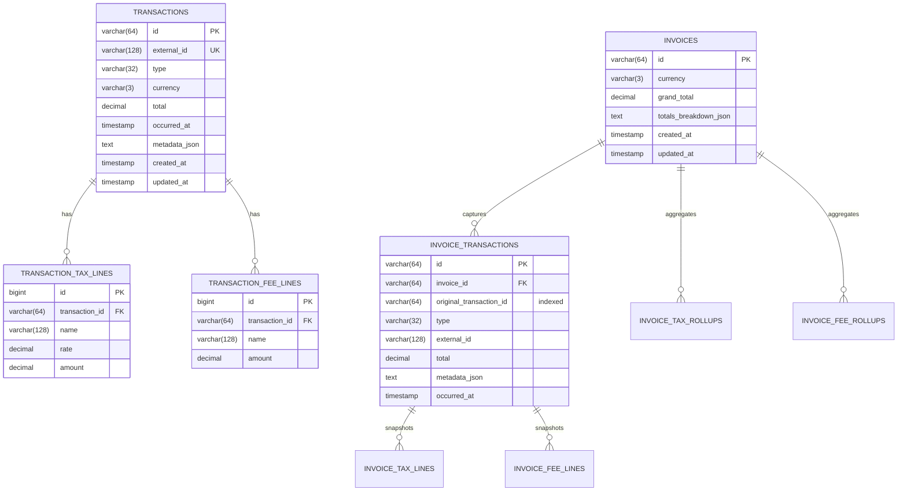

# Navan Commerce Architecture Document
## Multi-Modal Travel Inventory & Invoicing Microservice

---

## 1. Executive Summary & Design Philosophy

The Navan Commerce Travel Inventory and Invoicing service is designed to ingest multi-modal commercial travel transactions (`flight`, `hotel`, `rail`, `navan_fee`) and assemble immutable, legally compliant invoice snapshots. 

The architecture strictly adheres to three fundamental enterprise engineering tenets:
1. **Financial Integrity & Zero Drift:** Money is represented strictly with fixed-point decimal arithmetic (`BigDecimal` scale 2). Invoices are frozen snapshots using the Memento pattern—once created, changes to underlying bookings can never alter invoiced amounts.
2. **Defensive Concurrency & Idempotency:** Duplicate transactions are rejected at the database engine level via unique constraints. Concurrent duplicate writes are resolved deterministically without external distributed locks or message brokers.
3. **High-Throughput Operational Simplicity (Zero-Friction Pragmatism):** Built with pure Spring Boot 3.4 and Java 21/25, the system requires no external dependencies for local evaluation (file-backed disk SQL database), while providing full PostgreSQL 16 compatibility for staging environments.

---

## 2. High-Level System Architecture

The service follows a layered, hexagonal-inspired domain architecture with clear separation of concerns:

```
[ HTTP Clients / Booking Engines / Navan Support ]
                      │
                      ▼
┌─────────────────────────────────────────────────────────┐
│               REST Controllers (Web Layer)              │
│    • TransactionController       • InvoiceController    │
│    • HealthController            • GlobalExceptionHandler│
└──────────────────────────┬──────────────────────────────┘
                           │ DTOs (Records)
                           ▼
┌─────────────────────────────────────────────────────────┐
│              Service & Domain Logic Layer               │
│    • TransactionService          • InvoiceService       │
│    • InvoiceSnapshotEngine       • Aggregators          │
└──────────────┬───────────────────────────┬──────────────┘
               │                           │
               ▼                           ▼
┌───────────────────────────────┐ ┌───────────────────────┐
│ Polymorphic Strategy Registry │ │ Entity Repositories   │
│ • FlightTransactionHandler    │ │ • TransactionRepo     │
│ • HotelTransactionHandler     │ │ • InvoiceRepo         │
│ • RailTransactionHandler      │ │ • SnapshotRepo        │
│ • NavanFeeTransactionHandler  │ │                       │
└───────────────────────────────┘ └───────────┬───────────┘
                                              │
                                              ▼
┌─────────────────────────────────────────────────────────┐
│                   Database Engine                       │
│    File-backed Disk SQL (Local) / PostgreSQL 16 (Stage) │
└─────────────────────────────────────────────────────────┘
```

### Seam Responsibilities
- **Web Layer:** Performs request deserialization, input validation, HTTP status mapping, RFC 7807 problem details formatting, and pagination envelope bounding.
- **Service Layer:** Manages transaction boundaries (`@Transactional`), enforces mutation protection invariants (blocking mutations on invoiced transactions), and orchestrates snapshot generation.
- **Strategy Handlers:** Encapsulate vertical-specific validation, structural checks, and subtotal rollup rules for each transaction type.
- **Persistence Layer:** Enforces database constraints, foreign keys, cascade policies, and index-accelerated query execution.

---

## 3. Data Model & Schema Defense

### 3.1 Entity Relationship Diagram



### 3.2 Schema Design Justifications

#### A. Separation of `tax_lines` vs. `fee_lines`
The system models taxes and fees as distinct child relational tables rather than combining them into a generic "extras" column:
- **Regulatory & Audit Segregation:** Taxes (e.g., VAT, governmental passenger facility charges, local tourism taxes) carry statutory reporting requirements, specific tax rates, and tax authority filing obligations. Fees (e.g., airline YQ fuel surcharges, GDS distribution fees, merchant booking surcharges) represent commercial supplier costs and revenues.
- **Relational Normalization:** Storing them in dedicated tables (`transaction_tax_lines` and `transaction_fee_lines`) enables structured validation, indexability, and clean rollup aggregations without parsing JSON blobs.

#### B. Hybrid Relational + Typed JSON Strategy
Travel inventory attributes vary substantially across modalities:
- **Flight:** Origins, destinations, airline carriers, fare classes, and multi-segment flight `coupons`.
- **Hotel:** Property name, structured physical address (`street`, `city`, `country`), check-in/out dates, nights, nightly room rates, and optional stay extras.
- **Rail:** Multi-segment journey `legs`, train numbers, departure/arrival timestamps, and travel classes.
- **Navan Fee:** Specific `fee_kind` (`trip_fee` vs. `agent_call_fee`), fee descriptions, and `related_external_id`.

**Why the Hybrid Approach?**
1. *Against Single Table Inheritance (STI):* STI creates a wide, sparse database table with dozens of nullable columns. Adding a new travel vertical (e.g., car rentals or ferry bookings) requires DDL schema migrations that lock production tables.
2. *Against Untyped Metadata Blobs:* Pure untyped `varchar` blobs without validation lead to corrupt or incomplete database records.
3. *The Hybrid Solution:* Relational columns are used for universal queryable attributes (`id`, `external_id`, `type`, `currency`, `total`, `occurred_at`). Type-specific metadata is validated in the application layer via strongly typed Java records and polymorphic handlers (`TransactionTypeHandler<T>`), then stored in a `metadata_json` column. This guarantees complete schema agility with zero loss of type safety or validation rigor.

#### C. Temporal & Chronological Domain Validation
To prevent corrupted or impossible travel itineraries:
- **Hotel Stays:** Enforces strict parsing of `check_in` and `check_out` dates, requiring `check_out` to be strictly after `check_in` (`checkOut.isAfter(checkIn)`).
- **Flight Coupons:** Enforces ISO-8601 timestamp parsing and requires coupon `departure` to be strictly before `arrival` (`arrival.isAfter(departure)`).
- **Rail Journeys:** Enforces ISO-8601 timestamp parsing and requires journey leg `departure` to be strictly before `arrival` (`arrival.isAfter(departure)`).
- Inverted or unparseable date formats reject the request with HTTP `400 Bad Request` and detailed RFC 7807 problem details.

---

## 4. Identity, Concurrency & Idempotency Controls

### 4.1 Unique Identity Enforcement
Idempotency is guaranteed by placing a database-level `UNIQUE CONSTRAINT` on `transactions.external_id` (`idx_transactions_external_id`). In-memory locks or application-level `exists()` checks alone are insufficient in multi-instance production environments.

### 4.2 Concurrent Write Race Condition Resolution
When multiple concurrent requests submit the same `external_id` simultaneously:
1. Both requests pass application validation and enter `TransactionService.createTransaction`.
2. Both attempt an `INSERT` into the `transactions` table within their respective database transactions.
3. The database engine's unique B-tree index allows exactly one transaction to succeed (`201 Created`).
4. The concurrent transaction violates the unique constraint, and the database driver throws a `DataIntegrityViolationException`.
5. In Spring Data JPA, catching an integrity violation inside an active `@Transactional` session marks the persistence context as rollback-only. To prevent transaction context corruption, the controller sets the request attribute `external_id`, and `GlobalExceptionHandler` intercepts the exception.
6. The handler queries the winning transaction in a clean context and returns:
   - HTTP Status: `409 Conflict`
   - Payload: RFC 7807 problem details containing the winning transaction's server `id` at the root level (`{"status": 409, "title": "Conflict", "id": "txn_...", ...}`).
7. The system leaves **exactly one** record in the database.

*Verified via multithreaded integration test: 10 concurrent threads executing simultaneous creates result in 1 HTTP 201 and 9 HTTP 409 responses, with exactly 1 row persisted.*

### 4.3 Pessimistic Row Locking on Invoice Mutations (`PATCH /invoices/{id}`)
To guarantee invoice snapshot integrity when multiple concurrent modifications are submitted for the same invoice:
- The query method `InvoiceRepository.findByIdForUpdate(id)` applies an explicit `@Lock(LockModeType.PESSIMISTIC_WRITE)`.
- At the database level, this executes `SELECT ... FROM invoices WHERE id = ? FOR UPDATE`.
- The database engine places an exclusive row-level lock on the target invoice record. Any concurrent `PATCH` or `DELETE` transaction on that invoice is blocked until the active transaction commits.
- This prevents race conditions where interleaved snapshot clears and inserts could tear the snapshot collection, duplicate snapshots, or orphan child lines.

*Verified via multithreaded integration test: 10 concurrent threads racing to patch the same invoice with alternating transaction sets complete without torn snapshots or data corruption.*

### 4.4 Deadlock Prevention via Global Lock Ordering Hierarchy
When concurrent operations span both `transactions` and `invoices` (such as `PATCH /invoices` modifying an invoice while concurrent `PATCH /transactions` attempts to update constituent transactions), inverted lock acquisition orders can trigger database deadlocks (e.g., Operation A locks Invoice then Transaction; Operation B locks Transaction then Invoice).
- The service enforces a strict, deterministic **Global Lock Ordering Hierarchy**:
  $$\text{Transactions (ordered lexicographically by ID)} \prec \text{Invoices}$$
- In `InvoiceService` (`createInvoice` and `patchInvoice`), input transaction IDs are sorted deterministically (`txnIds.stream().sorted().toList()`), and transactions are loaded in a single batched operation (`findAllById`) **before** the target invoice lock (`findByIdForUpdate`) is acquired.
- In `TransactionService` (`patchTransaction`), only the targeted transaction row is evaluated.
- Because every codepath across the application acquires or touches resources strictly following $\text{Transactions} \prec \text{Invoices}$, circular wait conditions in the database resource allocation graph are mathematically impossible (Dijkstra's resource ordering theorem).

### 4.5 High-Volume Scalability & `count(*)` Query Elimination (`Slice<T>`)
Under high read volume with millions of bookings, Spring Data JPA's default `Page<T>` query executes an unindexed `SELECT count(*) FROM transactions` on every single request just to compute total elements. In high-throughput systems, this `count(*)` scans the entire table or primary index, causing severe CPU and I/O degradation.
- The service replaces full table count pagination with `Slice<T>` pagination via `findSliceBy(Pageable pageable)`.
- Under the hood, Hibernate executes `LIMIT limit + 1 OFFSET offset`, reading at most $N + 1$ records and executing **zero** `count(*)` queries.
- `slice.hasNext()` directly populates the `has_more` boolean in `PageResponse<T>`, enabling infinite scrolling and high-throughput pagination with minimal database overhead.

### 4.6 Arbitrary Offset-Limit Pagination Arithmetic
Standard Spring Data `PageRequest.of(pageNumber, pageSize)` assumes fixed page chunks where `pageNumber = offset / limit`. For arbitrary offsets that are not exact multiples of the limit (e.g., `offset=5, limit=10`), integer division rounds down to `page 0`, silently returning items `0–9` instead of items `5–14`.
- The service implements a custom `OffsetLimitRequest implements Pageable` that sets the exact SQL `OFFSET` (`query.setFirstResult((int) offset)`) and `LIMIT` (`query.setMaxResults(limit)`).
- Clients can request any arbitrary offset (`offset=7, limit=4`, etc.) and receive the exact mathematical item slice without table scan overhead.

---

## 5. Invoice Snapshotting & Immutability (The Memento Pattern)

### 5.1 The Frozen Snapshot Architecture
An invoice is an immutable accounting document. If a traveler modifies a flight or cancels a hotel room after an invoice has been generated, the invoice must reflect the state of the transactions at billing time.

The service implements the **Memento Pattern** via `InvoiceSnapshotEngine`:
1. When `POST /invoices` is executed, the engine loads the referenced transactions.
2. It creates deep-copy clone entities (`InvoiceTransactionSnapshotEntity`, `InvoiceTaxLineSnapshotEntity`, `InvoiceFeeLineSnapshotEntity`) and saves them in dedicated snapshot tables.
3. Once written, `GET /invoices/{id}` reads **only** from the snapshot tables. It performs zero live joins to the mutable `transactions` table.

```
Mutable Domain                              Frozen Snapshot
┌───────────────────────┐                    ┌────────────────────────────┐
│   TRANSACTIONS        │                    │   INVOICES                 │
│   (Subject to edits)  │                    │   (Immutable Legal Record) │
└───────────┬───────────┘                    └─────────────┬──────────────┘
            │                                              │
            │ Deep Copy via InvoiceSnapshotEngine          │
            └─────────────────────────────────────────────►│
                                             ┌─────────────▼──────────────┐
                                             │ INVOICE_TRANSACTIONS       │
                                             │ INVOICE_TAX_LINES          │
                                             │ INVOICE_FEE_LINES          │
                                             └────────────────────────────┘
```

### 5.2 Mutation Protection on Invoiced Transactions
To prevent financial divergence:
- **`PATCH /transactions/{id}`:** Before applying any update, the service queries `InvoiceTransactionSnapshotRepository.existsByOriginalTransactionId(id)`. If the transaction appears on **any** invoice, the update is rejected with `409 Conflict`, and no changes are persisted.
- **`DELETE /transactions/{id}`:** If the transaction is on any invoice, deletion is rejected with `409 Conflict`.
- **`DELETE /invoices/{id}`:** Deletes the invoice and its snapshot records. The underlying transactions remain completely intact and retrievable via `GET /transactions/{id}`.
- **`PATCH /invoices/{id}`:** Atomically reconstructs the snapshot lines from the current state of stored transactions.

### 5.3 Aggregation & Rollup Algorithms
- **Tax Rollup:** Groups tax lines across all invoiced transactions by composite key `(name, rate)` and sums amounts.
- **Fee Rollup:** Groups fee lines across all invoiced transactions by `name` and sums amounts.
- **Totals Breakdown:** Computes categorized subtotals (`flight`, `hotel`, `rail`, `trip_fee`, `agent_call_fee`) and the invoice `grand_total`.
- **Currency Validation:** Cross-currency invoicing is strictly prohibited. Submitting transactions with mixed currencies (e.g., EUR and USD) triggers an immediate `409 Conflict`.

### 5.4 High-Throughput Batch Fetching (N+1 Query Elimination)
To prevent N+1 query degradation when rendering invoices and transactions:
- When listing invoices via `GET /invoices`, naive lazy loading would fire separate SQL queries for each invoice's snapshots, tax lines, and fee lines (e.g. 50 invoices × 4 snapshots × 2 lines = 450+ queries).
- The service configures Hibernate batch fetching globally (`hibernate.default_batch_fetch_size: 100`) and explicitly on collections via `@BatchSize(size = 50)` on `InvoiceEntity.snapshots` and `@BatchSize(size = 100)` on snapshot tax/fee lines and transaction tax/fee lines.
- When any child collection is accessed, Hibernate executes a single batched query using `WHERE parent_id IN (?, ?, ?, ...)`, reducing hundreds of round trips to just 4 bulk queries total.

---

## 6. Money Representation & Precision

All monetary amounts (`total`, `fare`, `room_rate_per_night`, tax `amount`, fee `amount`, rollups, and invoice grand totals) use `java.math.BigDecimal` configured with:
- **Scale:** 2 decimal places (standard currency cents).
- **Rounding Mode:** `RoundingMode.HALF_UP`.
- **Database Column:** `DECIMAL(19, 2)`.

Floating-point data types (`float`, `double`, IEEE 754) are strictly disallowed across all entities, DTOs, and aggregations to prevent binary rounding errors.

---

## 7. High-Volume Performance & Scalability

### 7.1 Indexing Strategy
To maintain sub-millisecond query performance under millions of records:

| Index Name | Table & Columns | Purpose |
| :--- | :--- | :--- |
| `idx_transactions_external_id` | `transactions(external_id)` | **UNIQUE B-Tree.** Eliminates duplicate scans and drives $O(1)$ collision detection. |
| `idx_transactions_created_at` | `transactions(created_at DESC)` | Optimizes paginated list queries on `GET /transactions`. |
| `idx_invoices_created_at` | `invoices(created_at DESC)` | Optimizes paginated list queries on `GET /invoices`. |
| `idx_snapshot_orig_txn_id` | `invoice_transactions(original_transaction_id)` | B-Tree index making "is this transaction invoiced?" checks an instant index seek during `PATCH`/`DELETE`. |
| `idx_inv_txn_invoice_id` | `invoice_transactions(invoice_id)` | Accelerates invoice snapshot assembly during `GET /invoices/{id}`. |

### 7.2 Strict Bounded Pagination
To safeguard database and application memory:
- Both `GET /transactions` and `GET /invoices` require pagination parameters: `limit` (default: 50, maximum: 100) and `offset` (default: 0).
- Requests specifying `limit > 100` are rejected immediately with HTTP `400 Bad Request`.
- Queries are executed using database-level `LIMIT` and `OFFSET` clauses. In-memory pagination is strictly prohibited.

### 7.3 Resource Protection
- **Open-Session-In-View Disabled:** `spring.jpa.open-in-view=false` ensures database connections are released back to the HikariCP connection pool the instant a repository transaction completes, preventing pool exhaustion during slow client HTTP response streaming.
- **HikariCP Tuning:** Configured with minimum idle connections and leak detection thresholds.

### 7.4 What Breaks First Under Extreme Load (and Mitigations)

| Failure Point | Root Cause Under Heavy Load | Engineered Mitigation |
| :--- | :--- | :--- |
| **1. Deep Offset Pagination Latency** | As tables grow to tens of millions of rows, `OFFSET 500000 LIMIT 50` forces the database engine to scan 500,000 index entries before returning 50 rows. | Transition from `OFFSET` to **Keyset / Cursor Pagination** (`WHERE (created_at, id) < (cursor_time, cursor_id) ORDER BY created_at DESC, id DESC LIMIT 50`). Keyset pagination maintains constant $O(1)$ response time regardless of depth. |
| **2. HikariCP Connection Pool Starvation** | Spikes of concurrent writes contending for database transactions cause connection wait queues to back up, leading to `ConnectionTimeoutException`. | Keep transaction boundaries minimal (zero external network I/O inside `@Transactional`). Scale connection pool based on core capacity: $PoolSize = 2 \times Cores + EffectiveSpindles$. Read-only operations routed to read replicas. |
| **3. Unique Index B-Tree Lock Contention** | Massive concurrent writes with the same or adjacent `external_id` hash ranges cause page latch contention on the unique B-tree index. | Utilize hash-distributed surrogate keys or application-level pre-routing sharded by client/tenant account ID. |

---

## 8. Extensibility & Future Architecture

1. **Adding New Modalities:** To introduce a new vertical (e.g., `car_rental` or `ferry`), an engineer only needs to:
   - Add the enum value to `TransactionType`.
   - Implement a new `TransactionTypeHandler<CarRentalMetadata>`.
   - The strategy handler automatically self-registers in `TransactionHandlerRegistry` with zero changes required to database tables or core invoice engines.
2. **Read/Write Separation:** Under higher scale, read operations (`GET /transactions`, `GET /invoices`) can be directed to PostgreSQL read replicas using Spring's `AbstractRoutingDataSource`.
3. **Zero Schema Drift Management:** In production/staging environments, `spring.jpa.hibernate.ddl-auto=update` introduces severe schema drift and table locking risks. The service employs an explicit ANSI DDL schema (`src/main/resources/schema.sql`) executed on startup (`spring.sql.init.mode=always`), paired with strict Hibernate validation (`spring.jpa.hibernate.ddl-auto=validate`) in the staging profile. Any mismatch aborts deployment immediately, ensuring the database remains 100% compliant with entity contracts.

---

## 9. Verification & Conclusion

The Navan Commerce Travel Inventory and Invoicing service provides a robust, production-grade microservice that guarantees absolute financial accuracy, defensive concurrency, and pragmatic architectural simplicity. 

All invariants are rigorously verified by a multi-tiered test suite totaling **134 automated tests** runnable in a single command (`./mvnw test`):
- **12 Primary Criteria Integration Tests** (`TravelApiIntegrationTest`): Verifies multi-modal ingestion, 10-thread race conditions, trip invoice accuracy (685.70 EUR), snapshot immutability, mixed currency rejection, and mutation blocking.
- **22 Edge Cases & API Contract Integration Tests** (`TravelApiEdgeCasesIntegrationTest` & `SwaggerApiIntegrationTest`): Verifies missing fields, malformed metadata, cross-type payloads, mutable non-invoiced lifecycle (`PATCH`/`DELETE`), multi-rate tax rollups (VAT 7% and VAT 19%), invoice deletion unfreezing, arbitrary non-multiple offset pagination (`offset=5, limit=4`), temporal chronological validation (hotel, flight, rail), 10-thread concurrent invoice PATCH locking, boundary pagination (`limit=100` vs `limit=101`), half-up financial precision, and complete OpenAPI 3.0 / Swagger schema contract compliance.
- **100 Isolated Class-Level Unit Tests**: Verifies polymorphic Strategy handlers, temporal checks, domain entities, rollups, request DTOs, `OffsetLimitRequest`, exception mappers, centralized `ErrorCode` message resolution via `NavanBaseException`, single-roundtrip batch transaction loading, and service logic with zero external dependencies.
